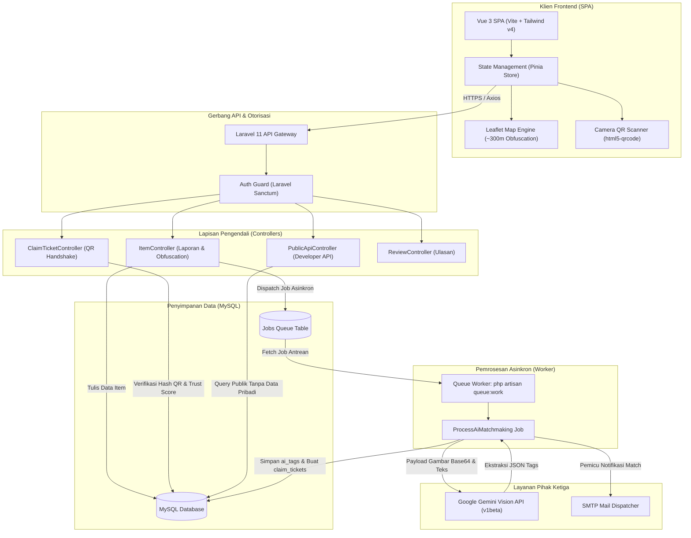
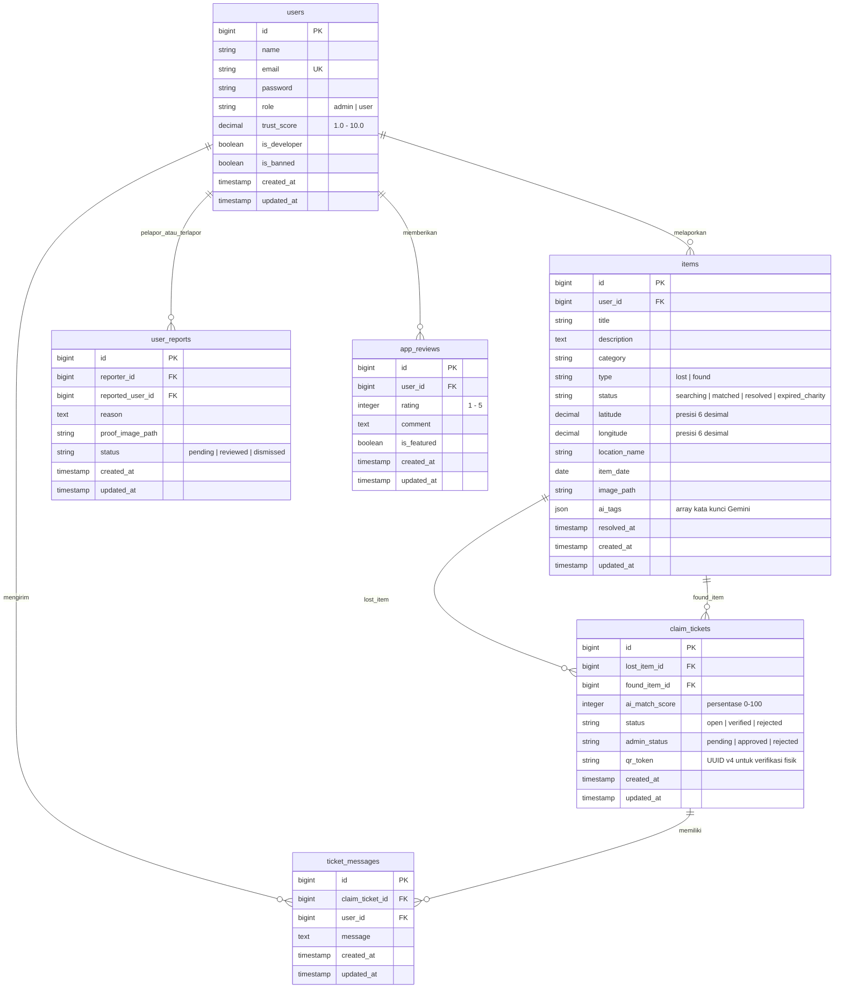

<p align="center">
  
</p>

<p align="center">
  <a href="https://vuejs.org/"></a>
  <a href="https://laravel.com/"></a>
  <a href="https://tailwindcss.com/"></a>
  <a href="https://www.mysql.com/"></a>
  <a href="https://ai.google.dev/"></a>
</p>

# NODUS - Reconnecting What's Lost

NODUS adalah ekosistem digital pelaporan dan penemuan barang terintegrasi yang memadukan komputasi visual Google Gemini AI, verifikasi fisik berbasis QR Handshake, serta penyamaran geolokasi publik. Platform ini dirancang untuk mendemokratisasi pemulihan kepemilikan barang secara aman, transparan, dan terukur, sekaligus mendukung target Pembangunan Berkelanjutan (SDGs 11: Kota Berkelanjutan dan SDGs 12: Konsumsi & Produksi yang Bertanggung Jawab) melalui automasi program donasi barang tak bertuan.

---

## 1. Konseptual & Fitur Ekosistem

* **Vision AI Matchmaking:** Ekstraksi kata kunci semantik dan visual dari foto barang laporan menggunakan model multimodal Google Gemini (`gemini-3.5-flash-lite` dengan otomatisasi *fallback* ke `gemini-flash-lite-latest` dan `gemini-3.1-flash-lite`). Proses klasifikasi dijalankan secara non-blocking melalui sistem antrean latar belakang (*Background Queue Worker*).
* **Secure QR Handshake:** Protokol verifikasi serah terima barang langsung tanpa membagikan nomor telepon, alamat, atau identitas pribadi. Penemu wajib memindai token QR kriptografis (UUID v4) yang digenerate khusus dari layar pelapor untuk memvalidasi resolusi barang.
* **Smart Location Obfuscation:** Pengaburan presisi koordinat publik (*latitude* & *longitude*) menjadi radius zona 300 meter menggunakan algoritma *Smart Directional Noise* (`$max_noise = 0.0025`). Penambahan offset hanya diarahkan ke sektor daratan terdekat guna mencegah titik koordinat melenceng ke laut atau area terlarang.
* **Trust Score & SDGs Upcycle:** Sistem reputasi dinamis berbasis skor kredit (skala 1.0 - 10.0) yang mengapresiasi integritas penemu dan pelapor (+0.5 setiap penyelesaian klaim terverifikasi). Sistem dilengkapi *cron scheduler* yang mendeteksi barang temuan berumur lebih dari 30 hari tanpa klaim untuk dialihkan statusnya menjadi *charity program* (SDGs Upcycle).
* **Developer Interoperability API:** Endpoint API publik (`GET /api/public/items`) terproteksi token Sanctum bagi unit satpam kampus, bot pesan instan, dan sistem mading digital eksternal dengan sanitasi data pribadi otomatis.

---

## 2. Arsitektur Sistem

Alur interaksi komponen arsitektur NODUS terbagi ke dalam lapisan presentasi (Vue 3 SPA), lapisan gerbang API (Laravel Sanctum), lapisan pemrosesan persisten (MySQL Database), serta lapisan komputasi kecerdasan buatan terdistribusi (Queue Worker & Google Gemini API):



---

## 3. Skema Database & Relasi (ER Diagram)

Pemetaan entitas relasional utama yang menopang siklus hidup pelaporan barang, pencocokan tiket klaim, evaluasi pengguna, dan sistem ulasan:



---

## 4. Logika Kode Inti (Core Logic Flows)

### 4.1 Asynchronous Matchmaking Workflow
Pemrosesan visi komputer dan inferensi model bahasa memerlukan waktu latensi antara 1.5 hingga 4 detik. Untuk mempertahankan performa respons API di bawah 150ms pada form frontend:

1. **HTTP Store Execution:** `ItemController@store` memvalidasi masukan pengguna, menyimpan file fisik gambar ke *storage disk*, membuat record `items` dengan status `searching`, dan segera memanggil:
   ```php
   ProcessAiMatchmaking::dispatch($item);
   ```
2. **Immediate HTTP Return:** Server langsung merespons ke browser dengan kode status `201 Created` beserta objek barang. Pengguna tidak mengalami *freezing* atau penundaan antarmuka.
3. **Queue Processing:** Worker latar belakang mengeksekusi `ProcessAiMatchmaking@handle`:
   - Membaca file gambar fisik, mengonversi ke stream *base64 inline_data*, dan mengirimkan prompt ke endpoint REST Google Gemini (`gemini-3.5-flash-lite`).
   - Melakukan parsing respon array JSON (contoh: `["kunci", "vario", "hitam", "smartkey"]`) dan menyimpan ke kolom `items.ai_tags`.
   - Mengambil seluruh barang aktif bertipe berlawanan (`type != current_type` dan `status == 'searching'`).
   - Menghitung koefisien kemiripan Jaccard irisan kata kunci:
     $$\text{Match Score} = \left( \frac{|\text{Tags}_A \cap \text{Tags}_B|}{|\text{Tags}_A \cup \text{Tags}_B|} \right) \times 100$$
   - Apabila skor mencapai ambang batas $\ge 60\%$, tiket klaim dibuat pada tabel `claim_tickets` dengan status `open`, `admin_status = 'pending'`, serta otomatis menghasilkan token UUID `qr_token`.

### 4.2 QR Verification & Handshake Resolution
Untuk mengeliminasi klaim palsu dan verifikasi tanpa bukti fisik, tombol resolusi klaim langsung telah dihapus dan digantikan oleh validasi token kriptografis:

1. **Generasi Token Pelapor:** Saat tiket klaim disetujui admin (`admin_status = 'approved'`), backend men-generate string UUID acak pada kolom `qr_token`. Pelapor membuka panel tiket dan menekan tombol **"Tampilkan QR Klaim"** yang merender kode QR SVG di layar.
2. **Pemindaian Sisi Penemu:** Penemu menekan tombol **"Buka Kamera Scanner"** di panel tiket miliknya. Komponen scanner (`html5-qrcode`) membaca kode dari layar pelapor.
3. **Validasi Backend Terisolasi:** Frontend penemu mengirimkan request:
   ```http
   POST /api/claim-tickets/{id}/verify-qr HTTP/1.1
   Content-Type: application/json

   {
     "token": "d3b07384-d113-4672-b7e6-77894a48f0e2"
   }
   ```
4. **Eksekusi Atomik:** Controller memverifikasi kesamaan token:
   ```php
   if (empty($ticket->qr_token) || $ticket->qr_token !== trim($request->input('token'))) {
       return response()->json(['message' => 'Kode QR tidak cocok atau tidak valid.'], 422);
   }
   ```
   Di dalam transaksi basis data atomik (`DB::transaction`):
   - Status tiket berubah menjadi `verified`.
   - Status kedua barang (`lost_item` dan `found_item`) berubah menjadi `resolved`.
   - Kolom `trust_score` milik pelapor dan penemu masing-masing dinaikkan sebesar `+0.5` (maksimal 10.0).

---

## 5. Instalasi Lingkungan Lokal

### Prasyarat Sistem
* PHP $\ge$ 8.2 (Ekstensi: `pdo_mysql`, `curl`, `mbstring`, `fileinfo`, `gd`)
* Composer $\ge$ 2.6
* Node.js $\ge$ 18.x & NPM $\ge$ 9.x
* MySQL Server $\ge$ 8.0

### Langkah Instalasi
Clone repositori dan pasang seluruh dependensi backend dan frontend:

```bash
# 1. Klon repositori
git clone https://github.com/WanXdOffc/Nodus.git
cd Nodus

# 2. Instal dependensi PHP (Composer)
composer install

# 3. Instal dependensi JavaScript (NPM)
npm install

# 4. Salin template konfigurasi lingkungan
cp .env.example .env

# 5. Generate application key
php artisan key:generate
```

### Konfigurasi File Lingkungan (.env)
Sesuaikan pengaturan basis data, antrean, dan API Key Google Gemini pada file `.env`:

```ini
APP_NAME=NODUS
APP_ENV=local
APP_KEY=base64:...
APP_DEBUG=true
APP_URL=http://127.0.0.1:8000

# Basis Data
DB_CONNECTION=mysql
DB_HOST=127.0.0.1
DB_PORT=3306
DB_DATABASE=nodus_db
DB_USERNAME=root
DB_PASSWORD=

# Wajib gunakan antrean database untuk pemrosesan AI asinkron
QUEUE_CONNECTION=database
SESSION_DRIVER=database

# Kredensial AI Vision
GEMINI_API_KEY="masukkan_google_gemini_api_key_anda"
GEMINI_MODEL="gemini-3.5-flash-lite"
```

### Inisialisasi Basis Data & Skenario Awal
Jalankan migrasi tabel dan penyemaian data skenario terverifikasi:

```bash
php artisan migrate:fresh --seed
```

Data bawaan seeder menyediakan akun pengujian:
* **Admin / Developer:** `budi@nodus.com` (password: `password`) atau `admin@nodus.com` (password: `password`)
* **Pengguna Pelapor (Andi):** `andi@nodus.com` (password: `password`)
* **Pengguna Penemu (Citra):** `citra@nodus.com` (password: `password`)

### Menjalankan Server Lokal (Perlu 3 Terminal Terpisah)
Buka 3 tab terminal terpisah di root direktori proyek:

```bash
# Terminal 1: Menjalankan Backend Laravel Server
php artisan serve

# Terminal 2: Menjalankan Vite Development Server
npm run dev

# Terminal 3: Menjalankan Queue Worker (Wajib aktif untuk inferensi Gemini AI)
php artisan queue:work
```

Untuk memverifikasi koneksi Gemini AI secara instan melalui CLI tanpa frontend:
```bash
php artisan nodus:test-ai --clean
```

---

## 6. Panduan Deployment Server Produksi

### 6.1 Kompilasi & Optimasi Aplikasi
Sebelum meluncurkan aplikasi ke lingkungan produksi, lakukan kompilasi aset frontend dan caching internal Laravel:

```bash
# 1. Instalasi dependensi produksi tanpa development packages
composer install --no-dev --optimize-autoloader

# 2. Bersihkan dan bangun cache framework
php artisan optimize:clear
php artisan config:cache
php artisan route:cache
php artisan view:cache
php artisan event:cache

# 3. Build aset statis frontend
npm run build
```

### 6.2 Konfigurasi Web Server (Nginx)
Arahkan direktori *Document Root* Nginx langsung ke subdirektori `/public`. Contoh blok konfigurasi `/etc/nginx/sites-available/nodus`:

```nginx
server {
    listen 80;
    listen [::]:80;
    server_name nodus.domainanda.com;
    root /var/www/nodus/public;

    add_header X-Frame-Options "SAMEORIGIN";
    add_header X-Content-Type-Options "nosniff";

    index index.php;

    charset utf-8;

    location / {
        try_files $uri $uri/ /index.php?$query_string;
    }

    location = /favicon.ico { access_log off; log_not_found off; }
    location = /robots.txt  { access_log off; log_not_found off; }

    error_page 404 /index.php;

    location ~ \.php$ {
        fastcgi_pass unix:/var/run/php/php8.2-fpm.sock;
        fastcgi_param SCRIPT_FILENAME $realpath_root$fastcgi_script_name;
        include fastcgi_params;
        fastcgi_hide_header X-Powered-By;
    }

    location ~ /\.(?!well-known).* {
        deny all;
    }
}
```

### 6.3 Pengelolaan Worker Permanen (Linux Supervisor)
Sistem antrean asinkron harus dikelola oleh supervisor daemon agar proses tetap hidup (*auto-restart*) bila terjadi lonjakan memori atau kegagalan worker:

1. Buat file konfigurasi worker di `/etc/supervisor/conf.d/nodus-worker.conf`:
   ```ini
   [program:nodus-worker]
   process_name=%(program_name)s_%(process_num)02d
   command=php /var/www/nodus/artisan queue:work database --sleep=3 --tries=3 --max-time=3600
   autostart=true
   autorestart=true
   stopasgroup=true
   killasgroup=true
   user=www-data
   numprocs=2
   redirect_stderr=true
   stdout_logfile=/var/www/nodus/storage/logs/worker.log
   stopwaitsecs=3600
   ```
2. Muat dan jalankan service supervisor:
   ```bash
   sudo supervisorctl reread
   sudo supervisorctl update
   sudo supervisorctl start nodus-worker:*
   ```

### 6.4 Penjadwalan Tugas Otomatis (Cron Job)
Tambahkan entri crontab sistem untuk mengeksekusi pemeriksaan kedaluwarsa barang 30 hari (*Charity Upcycle*):

```bash
* * * * * cd /var/www/nodus && php artisan schedule:run >> /dev/null 2>&1
```

---

## 7. Pengujian Unit & Fitur (Testing Suite)

Seluruh fungsionalitas logika bisnis, otorisasi Sanctum, enkripsi obfuskasi koordinat geografis, serta integritas API diuji menggunakan PHPUnit:

```bash
# Menjalankan seluruh test suite
php artisan test

# Menjalankan pengujian spesifik AI Matchmaking
php artisan test --filter=AiMatchmakingJobAndOptimizationTest

# Menjalankan pengujian verifikasi QR Handshake
php artisan test --filter=QrHandshakeTest
```

---

## 8. Lisensi

Proyek ini didistribusikan di bawah lisensi terbuka [MIT License](LICENSE).
